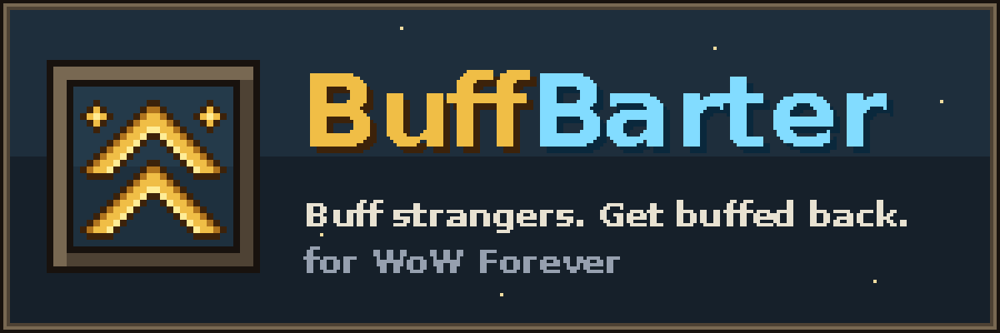

# BuffBarter

**Buff strangers. Get buffed back.**

BuffBarter turns buffing into a friendly trade. It shows a small icon on the nameplate of every nearby player who is missing one of your buffs, buffs them with a click, can politely ask for a buff in return and lets every class request buffs from others. A statistics window shows how much you gave, how much you got and who returned the favor.

Made for **WoW Forever**, including its new camp buffs.

## Who can use it

| Your class | What you get |
|---|---|
| Paladin | Blessing icons, respecting "one blessing per paladin" (shows when a click would replace your own blessing) |
| Priest | Power Word: Fortitude, Divine Spirit for mana users (if talented) |
| Mage | Arcane Intellect (never offered to warriors and rogues) |
| Druid | Mark of the Wild, Thorns for players with the tank role |
| Every class | One-click buff requests and statistics |

## Features

### Buff icons on nameplates

- Shows the first buff a player is missing, based on sensible class rules (no Wisdom for warriors, no Might for casters, Kings first for tanks).
- **Click the icon to buff.** BuffBarter briefly targets the player, casts and switches back to your previous target.
- **Orange "Camp":** the player only has the weaker camp version. Your buff replaces it.
- **Yellow timer:** your own buff runs out soon.
- **Purple "Swap"** (paladins): a click would replace your current blessing on that player.
- Faded icons for players out of range.

### PvP warning

If a player is PvP flagged and you are not, the icon shows a faction emblem and a red border, and the tooltip warns you that buffing will flag you too. You can also let BuffBarter skip flagged players completely.

### Camp buff aware

WoW Forever camps hand out weaker copies of class buffs that do not stack with the real ones. BuffBarter treats them as "upgrade possible", or as "already buffed" if you prefer.

### Ask for a buff back

After you buff a priest, mage, druid or paladin, BuffBarter can whisper them and ask for their buff, but only if you do not have it yet.

- Your own texts per class, in English and German
- Buffs as clickable spell links, so everyone sees the right spell in their own language
- At most once per player every 30 minutes, never inside instances

### One-click buff requests (every class)

A small "ask" icon appears next to priests, mages, druids and paladins who can give you a buff you are missing. One click sends a friendly whisper. Great for warriors, rogues, hunters and everybody else.

### Statistics

`/barter stats` opens a window with:

- buffs given and received
- **buffed back rate:** how many of the players you buffed buffed you too
- **answer rate:** how many of your requests were answered
- breakdowns by class, race and buff with icons, and your most frequent buff partners
- camp buffs received

## Settings

Type `/barter` or open *Options > AddOns > BuffBarter* to:

- switch buff icons, one-click buffing, request icons and strangers on or off
- choose how camp buffs and PvP flagged players are handled
- write your own whisper texts (placeholders: `{name}`, `{buff}`, `{ask}`, `{me}`)
- choose the language of your whispers

## Commands

| Command | What it does |
|---|---|
| `/barter` | Open the settings |
| `/barter toggle` | Icons on or off |
| `/barter stats` | Statistics window |
| `/barter preview` | Show the whisper your target would get |
| `/barter lang de` / `en` | Whisper language for your target |
| `/barter bind KEY` / `unbind` | Key that buffs the player under your mouse |
| `/barter scan` | List buffs with spell IDs on your target |
| `/barter camp FAMILY ID` | Register a camp buff, e.g. `/barter camp KINGS 123456` |
| `/barter help` | All commands |

## Good to know

- **Fair play:** every cast needs your click. BuffBarter never casts or whispers on its own, except the optional "ask back" whisper right after you buffed someone.
- **Combat:** icons are hidden in combat and come back afterwards.
- **Instances:** addons cannot whisper inside instances, and friendly nameplates may not be available there.
- **Camp buffs:** if a camp buff is not recognised yet, use `/barter scan` near the camp and register it with `/barter camp`. Please post the IDs in the comments so they can be built in.

## Languages

English and German. Translations are welcome.

## Feedback

Found a bug or have an idea? Leave a comment.
